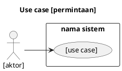
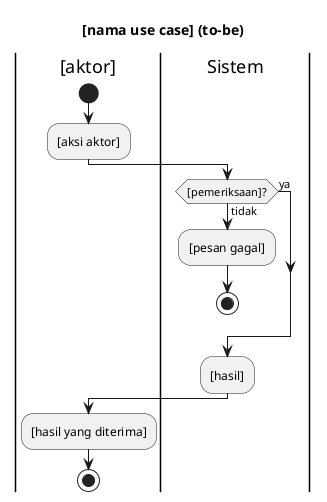

# FSD [nomor permintaan]: [judul singkat]

Versi [nomor], [tanggal]. Disusun oleh [nama BA].

<!--
Petunjuk umum:
- FSD menjelaskan bagaimana sistem harus berperilaku untuk setiap user story di PRD. Developer membuat kode dari dokumen ini, jadi setiap hal yang tidak ditulis akan ditebak.
- Diagram ditulis dalam PlantUML (use case dan activity diagram) atau Mermaid (ERD dan sequence diagram).
- Hal yang tidak bisa diputuskan BA sendiri dicatat di pertanyaan terbuka.
- Hapus komentar petunjuk setelah dokumen selesai.
-->

## Rujukan

| Dokumen | Isi yang dirujuk |
| --- | --- |
| `brd-[permintaan].md` |  |
| `prd-[permintaan].md` |  |

## Use case diagram

<!-- Semua aktor dan use case sistem baru, dengan batas sistem. Sebutkan user story yang menjadi dasar setiap use case. -->

## Spesifikasi use case

### UC[nomor] [nama use case]

| Bagian | Isi |
| --- | --- |
| Aktor |  |
| User story | US-[nomor] |
| Prakondisi |  |
| Pascakondisi |  |

**Alur utama**

1. 

**Alur alternatif**

- A1, [nama kondisi]: 

**Alur pengecualian**

- E1: [kondisi]. Pengguna melihat pesan `[pesan persis]`.

## Activity diagram

<!-- Proses to-be. Pakai swimlane untuk setiap aktor dan sistem. Setiap cabang gagal berakhir dengan pesan yang sama dengan alur pengecualian. -->

## Aturan bisnis

<!-- Beri nomor RB-1, RB-2, dan seterusnya. Satu aturan per baris, cukup jelas untuk diuji. -->

| Nomor | Aturan | Sumber |
| --- | --- | --- |
| RB-1 |  |  |

## ERD dan kamus data

<!-- ERD logis dalam Mermaid (erDiagram), lalu kamus data: atribut, tipe, wajib atau tidak, aturan validasi, arti bisnis, dan asal datanya di spreadsheet sekarang. -->

## Validasi dan pesan

| Kondisi | Pesan yang dilihat pengguna |
| --- | --- |
|  |  |

## Dampak ke proses kerja dan data

<!-- Langkah SOP yang berubah atau hilang, peran yang berubah, dan data yang harus dipindahkan atau dibersihkan dari spreadsheet sebelum sistem dipakai. Keputusan cakupan diberi nomor KEP-1, KEP-2, dan seterusnya. -->

| Bagian | Sekarang | Setelah sistem berjalan | Tindakan sebelum rilis |
| --- | --- | --- | --- |
|  |  |  |  |

## Matriks traceability

| Kebutuhan bisnis | User story | Acceptance criteria | Use case dan alur |
| --- | --- | --- | --- |
| BR-1 | US-1 | AC-1 |  |

## Pertanyaan terbuka

| Nomor | Pertanyaan | Dampak | Status |
| --- | --- | --- | --- |
| PT-1 |  |  |  |

## Riwayat perubahan

| Versi | Tanggal | Perubahan |
| --- | --- | --- |
| 1.0 |  | Versi awal |
